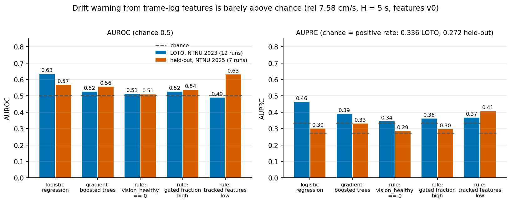
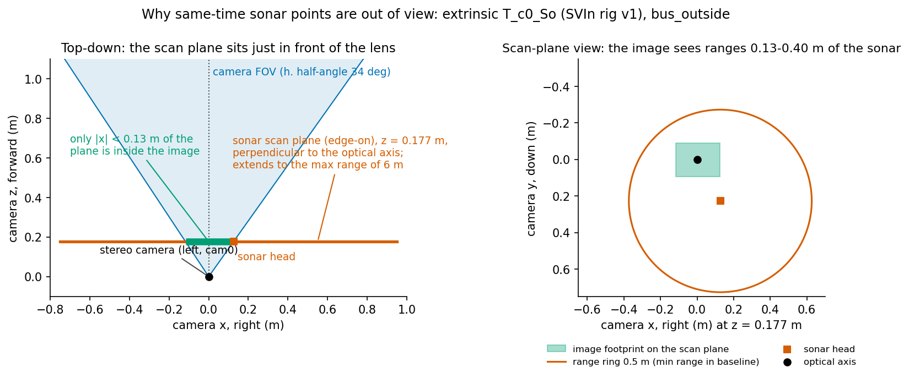

# uw-vslam-bench: underwater stereo-inertial state estimation and inspection, with measured baselines

Benchmark harness for underwater stereo-inertial estimation research: shared evaluation and baseline
runners, plus the two projects whose baselines came out negative. The four projects with positive baselines
live in their own repositories (below). All runs are offline (recorded bags); nothing ran on a vehicle.

## Projects (each in its own repository)

| Project | Repository | Baseline result |
|---|---|---|
| Tightly coupled DVL that survives dropouts (+ the `uw_ct_vio` estimator) | `uw-vio-dvl` | 20 s camera blackout: mean ATE **3.88 m -> 0.66 m** with (simulated) DVL; no dropout scenario worse than no DVL |
| CUDA KLT stereo front end | `uw-gpu-klt` | front end 2.0x (ws1) / 4.9x (laptop) faster, no end-to-end ATE loss |
| Auto-generated inspection report (detector + VLM) | `uw-inspect-report` | context verifier confirms 8/8 true findings at precision 0.89 (crop-only: 0/8) |
| In-water stereo calibration health check | `uw-calib-health` | differential mode: every >= 0.2 deg change detected, 0 false alarms |

This repository keeps the shared benchmark harness and the two negative results:

| # | Project | Dir | Result |
|---|---|---|---|
| 5 | Learned localization-failure warning | `health/` | LOTO AUROC 0.63, held-out AUROC 0.57 (chance 0.5): **negative** |
| 6 | Sonar projected into the camera image | `sonar_cam/` | AFRL rig: scan plane never in camera view, no association: **negative** |

### Negative results at a glance

| Learned failure warning (`health/`) | Sonar in camera image (`sonar_cam/`) |
|---|---|
|  |  |
| AUROC / AUPRC barely above chance, LOTO on NTNU underwater 2023 and held-out NTNU 2025; details and risk-vs-time plot in [`health/README.md`](health/README.md). | The scan plane sits 0.177 m ahead of the lens, perpendicular to the optical axis, so same-time sonar points are out of view; sweeps and overlays in [`sonar_cam/README.md`](sonar_cam/README.md). |

Regenerate all figures: `python3 health/make_figures.py` and `python3 sonar_cam/make_figures.py` (the latter needs `sonar_cam/out/`, see its README).

The ablation/baseline runners in `scripts/` (`uwct_ablate*.sh`, baselines) expect a built `uw-vio-dvl`.
`scripts/evaluate.py` + `geometry.py` (ATE/RPE with hand-eye) are also vendored in `uw-vio-dvl`.

Estimator base (uw-vio-dvl `DESIGN_V2.md`): NTNU 2023 subset-3, 6 trajectories with mocap, mean ATE **0.401 m** / RPE
6.75 % (baselines on the same bags: Basalt 1.10 m with the in-air stereo extrinsic, SVIn 1.80 m, ORB-SLAM3
initialises on 3/6, OpenVINS 3/6 with dynamic init). On the NTNU 2025 dev set with the same in-water stereo
for both: ours (huber 0.5) 0.552 m / 2.97 % vs Basalt 0.583 m / 2.24 % (better ATE, worse RPE).

## Datasets

- NTNU underwater (2023 subset-3 with mocap; 2025 mclab/fjord with ReAqROVIO reference; fjord_6 kept blind).
- AFRL stereo-VI underwater "bus_outside" (COLMAP GT; Imagenex 831L profiling sonar).
- Not yet: a real DVL dataset (Heriot-Watt Tank dataset needs a request form; SOLAQUA unverified).

## Layout

- `health/` frame-log features, drift labels, LOTO/held-out evaluation.
- `sonar_cam/` sonar decoding, projection, sonar-vs-stereo baseline.
- `scripts/` evaluation (`evaluate.py`: ATE/RPE with hand-eye), dataset tools, ablation and benchmark runners.
- `configs/`, `patches/` baseline configs and build patches; `PLAN.md` overall research plan (estimator design notes moved to uw-vio-dvl).

Not in the repo: datasets, `deps/` (GTSAM 4.2 local prefix), `third_party/` (separate clones; SuperPoint
weights, MASt3R and others are non-commercial), build trees, large outputs.

## Build (summary)

GTSAM 4.2.0 (+unstable) built to a local prefix (see `DESIGN_PHASE2.md` / ws1 build script), ROS 2 Jazzy
(rosbag2), OpenCV 4. `colcon build --base-paths uw_ct_vio --cmake-args -DGTSAM_DIR=<prefix>/lib/cmake/GTSAM
-DGTSAM_UNSTABLE_DIR=<prefix>/lib/cmake/GTSAM_UNSTABLE -DBUILD_TESTING=ON`. Source ROS from bash, not zsh.
Each project README has its exact commands.

## Licences of models used

OWLv2 and Qwen3-VL-4B-Instruct: Apache-2.0. GTSAM: BSD. cuVSLAM, GenZ-LIO, AirSLAM: ideas only, no code.
This repository has no licence file yet: choose one before publishing.
