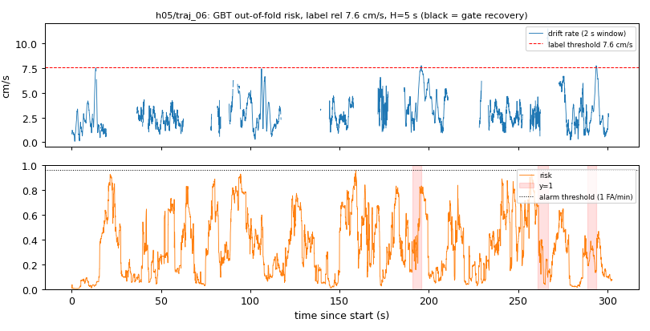
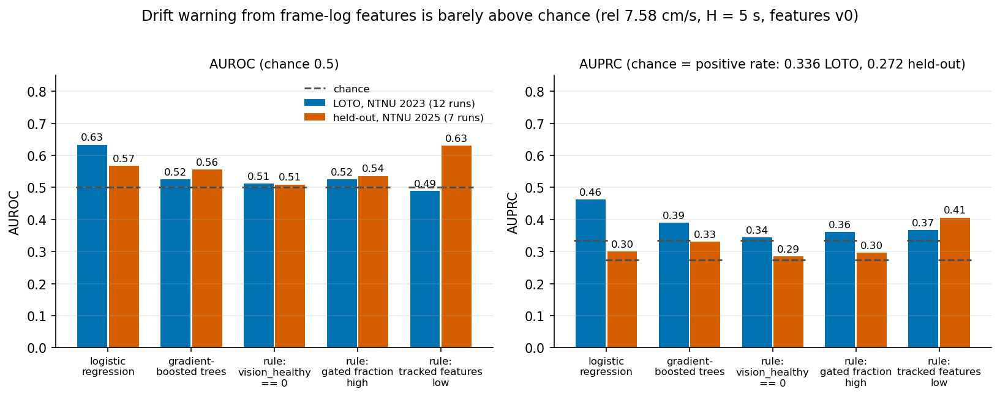
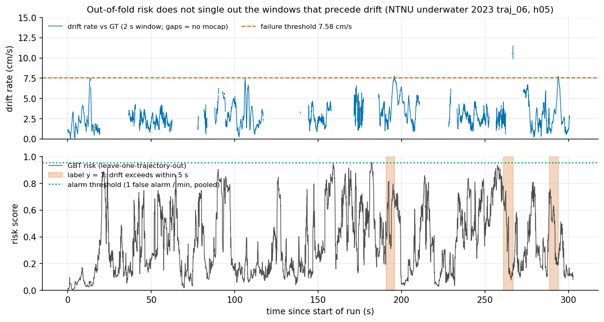

# Localization health / failure warning for uw_ct_vio

Research prototype. Question: from signals available online at time `t`, can we predict that the VIO's drift
will exceed a threshold within the next `H` seconds (so autonomy or the pilot gets a 2-5 s warning and can slow
down, rise, or hand over to DVL / sonar)?

STATUS (2026-11-04): LOTO (v0, v1) and the held-out NTNU 2025 test are done; the result is a negative baseline (see Reading). The held-out alarm numbers are saturated and not meaningful.

## Files

| file | purpose |
|---|---|
| `labels.py` | window drift vs GT, failure label, event onsets (non-causal, uses GT and the future) |
| `features.py` | online-causal features from the frame log |
| `metrics.py` | AUROC / AUPRC, alarm episodes, false alarms per minute, event recall, lead time |
| `data.py`, `make_manifest.py` | run registry / manifest from `results/ws1_sync` |
| `run_health.py` | model selection (LOTO), held-out test, tables, plot |
| `tests/test_health.py` | pytest: label timing on a synthetic drift burst, feature causality, metrics |

## Label definition

1. Drift of a window. For frame time `t_i` take the window `[t_i, t_i + W]`, `W = 2 s` (the end frame must be
   within 60 ms of `t_i + W`). With `X = T_body_cam` from `evaluate.hand_eye` on the whole run (GT moved onto
   the camera: `T_world_body @ X`), relative motions `d = inv(P_i) P_k` of estimate and GT are compared:
   `err = inv(d_gt) d_est`. `trans_mps = |err_t| / W` (m/s), `rot_dps = angle(err_R) / W` (deg/s). No world
   alignment is involved, so slow global drift does not matter, only local relative-motion error.
2. A window is **invalid** (NaN, never labelled across a gap) if the GT or estimate stamps inside it have a gap
   > 0.25 s, or the estimate / GT stamp is missing (> 20 ms from the frame stamp).
3. A frame "exceeds" if its window is valid and `trans_mps > thr`. (Rotation drift is computed and stored, but it
   is not used in the label: on traj_06 its median is 1.5 deg/s, dominated by mocap/hand-eye noise.)
4. `y_H(t) = 1` iff some frame `j` with `t <= t_j <= t + H` exceeds, or a gate recovery (the `recoveries` counter
   increases) happens at a frame with `t < t_j <= t + H`. `y_H(t) = 0` iff not 1, at least 80 % of the frames in
   `[t, t+H]` have a valid window, and the run lasts to `t + H`. Otherwise `y = NaN` (excluded from training and
   scoring). So `y` goes high exactly `H` s before the first exceeding window starts (tested).
5. Thresholds: `abs` = 5 cm/s; `rel` = 3 x the median window drift over the NTNU 2023 h05 runs (one fixed number,
   also applied to the 2025 set and to the nolcn config). Horizons H in {2, 5} s -> four label sets.
6. Events (for lead time / missed events): exceed-or-recovery frames, clustered; a new event starts when the gap
   to the previous such frame is > H. Onset = first frame of the cluster.

Primary label set: `rel`, H = 5 s (pre-declared, see Results). Reason (chosen from label statistics, not model results): on traj_06 the
`abs` 5 cm/s threshold is only about 2x the median window drift, so it is near the measurement noise floor
(positive rate 0.63-0.70 at H = 5, 0.42-0.49 at H = 2 on the 12 runs); a warning for "drift above noise" is not a meaningful target.
All four label sets are computed and reported in `results/v0/metrics.csv` and `results/v1/metrics.csv`.

## Features (all causal: frame-log rows <= t only)

Instantaneous: tracked, stereo, new_landmarks, landmark_factors, gated, candidates, vision_used, vision_healthy,
consecutive_gated, n_features, img_mean, img_std, gated_frac = gated / max(1, landmark_factors + gated).
Rolling over (t-w, t], w in {1, 3, 5} s: mean, min and least-squares slope (per second) of tracked, stereo,
landmark_factors, gated_frac, img_mean, img_std (54 features). `time_since_recovery_s` (capped at 120 s, also the
value before the first recovery). 68 features in v0. The DVL columns are not used (DVL off in these runs, constant
zeros). IMU statistics are not used (would need bag reading).

v1 adds 28 motion features computed from the run's own TUM (poses with stamp <= t, backward differences over 0.3 s, world frame): angular rate (deg/s), world-z yaw rate (abs, deg/s), translational speed (m/s), acceleration magnitude (m/s^2), each instantaneous plus mean and max over 1/3/5 s.

## Models and evaluation

* Rules (no training; the alarm threshold is chosen on the training out-of-fold scores like for the models):
  `vision_healthy == 0`; 1 s mean of gated_frac (high); 1 s mean of tracked (low).
* Logistic regression (standardised, class-balanced, C in {0.01, 0.1, 1}).
* `HistGradientBoostingClassifier` (lr 0.05, 150 iterations, min leaf 100, L2 1, depth in {3, 5}).
* Hyper-parameters are picked per label set by pooled LOTO AUPRC on NTNU 2023 only.
* LOTO: 6 folds over trajectories; both configs (h05, nolcn) of the left-out trajectory are held out and both
  configs of the other five are used for training. Held-out: train on all of NTNU 2023 (both configs), test on
  NTNU 2025 (mclab_1/2, fjord_1..5; fjord_6 excluded in `make_manifest.py` and refused in `run_health.py`);
  nothing is tuned on it.
* Alarm = risk >= threshold. Threshold = smallest value giving <= 1 false alarm per minute on the pooled LOTO
  out-of-fold scores. A false alarm is an alarm episode (flagged frames merged if < 1 s apart) with no `y = 1`
  frame and at least one `y = 0` frame, per minute of labelled-negative time. For LOTO the threshold is chosen
  on the same out-of-fold scores it is applied to (slightly optimistic); for the held-out set it comes from LOTO
  only, so its achieved false-alarm rate on the held-out set is reported and can differ from 1/min. The
  held-out `oracle_*` columns use a threshold chosen on the held-out scores (optimistic, for reference only).
* Event recall = fraction of events with an alarm frame in `[onset - H, onset]`; lead time = onset - first such
  alarm (at most H); "missed" = no alarm in that interval. Alarms after the onset do not count.
* AUPRC chance level = the positive rate (`pos_rate` column).

## Verified so far

* `python3 -m pytest -q health/tests` -> 8 passed (incl. motion-feature causality and a constant-turn value check).
* Synthetic drift burst: label rises exactly H s before the onset of the first exceeding window (within one
  frame); recovery label and undefined tail; GT-gap windows invalid; features unchanged if later data is altered
  or truncated; lead-time / miss / false-alarm accounting.
* Pipeline smoke run (`run_health.py`, plot, tables) on the traj_06 h05 log duplicated as fake train / held-out
  runs: it runs end to end (numbers are meaningless there: the same data is in train and test).
* Prototype frame log generated on the laptop (traj_06, flags: `--lcn 2 --lcn-stereo 0
  --stereo-from-intrinsics 1 --huber-k 0.5`, IMU yaml with gyro random walk set to 1e-2 because
  `imu_gw1e-2.yaml` is not on the laptop; this assumes "gw" means gyroscope random walk): 6056 frames, 3313 with a
  valid 2 s window (mocap gaps), 0 gate recoveries, median window drift 2.7 cm/s. The real results use the ws1 logs (IMU gyro random walk 2.866e-5 there; the prototype used 1e-2).
* Within-traj_06 sanity check (train on the first half minus 10 s, test on the second half; one run, not a
  proper split): AUROC about 0.4-0.5 for logreg, GBT and all three rules at abs H = 2 and H = 5. The `rel` label
  sets had a single class in the training half and were not evaluated. Not evidence of what the full LOTO will
  show, but it is a warning that these frame-log signals may carry little drift information.

## Results (NTNU 2023 leave-one-trajectory-out; held-out results follow below)

Data: 6 trajectories x 2 configs = 12 runs, 43.5k frames per config at about 20 Hz; 16-20k frames per config have a labelled y (mocap gaps). Every run has 0 gate recoveries (h05 and nolcn), so the recovery term of the label never fires and all positives are drift positives. Median window drift (h05) 2.53 cm/s -> rel threshold 7.58 cm/s.

Primary label set, pre-declared rule: `rel`, H = 5 s, chosen because the `abs` 5 cm/s threshold is about 2x the median drift (noise floor; positive rate 0.63-0.70 at H = 5) and the `rel` set is the next candidate by threshold, with H = 5 matching the 2-5 s warning goal. The rule was fixed before any LOTO model result was seen (it was based on label statistics of a single prototype run). Selected hyper-parameters: logreg C = 1.0, GBT depth 5.

### Primary: rel 7.58 cm/s, H = 5 s, LOTO

v0 = frame-log features only (68). v1 = v0 + 28 motion features (96, see Features). Same labels, folds, grids and alarm-threshold protocol; results in `results/v0/` and `results/v1/` (metrics.csv, dataset_stats.csv, chosen.json, run.log with every per-fold line, risk_plot.png).

#### v0 (frame log only)

| model | set | frames | pos rate (chance AUPRC) | AUROC | AUPRC | events | detected | event recall | median lead s | FA/min |
|---|---|---|---|---|---|---|---|---|---|---|
| logreg C=1.0 | LOTO-h05 | 15979 | 0.305 | 0.617 | 0.437 | 29 | 8 | 0.28 | 3.9 | 0.11 |
| logreg C=1.0 | LOTO-nolcn | 16672 | 0.365 | 0.641 | 0.486 | 40 | 21 | 0.53 | 4.2 | 1.70 |
| logreg C=1.0 | LOTO-all | 32651 | 0.336 | 0.633 | 0.462 | 69 | 29 | 0.42 | 4.2 | 0.89 |
| gbt depth=5 | LOTO-h05 | 15979 | 0.305 | 0.547 | 0.383 | 29 | 5 | 0.17 | 3.8 | 0.43 |
| gbt depth=5 | LOTO-nolcn | 16672 | 0.365 | 0.506 | 0.396 | 40 | 10 | 0.25 | 3.5 | 1.36 |
| gbt depth=5 | LOTO-all | 32651 | 0.336 | 0.525 | 0.390 | 69 | 15 | 0.22 | 3.8 | 0.89 |
| rule: vision_healthy==0 | LOTO-h05 | 15979 | 0.305 | 0.511 | 0.312 | 29 | 0 | 0.00 | - | 0.00 |
| rule: vision_healthy==0 | LOTO-nolcn | 16672 | 0.365 | 0.513 | 0.375 | 40 | 0 | 0.00 | - | 0.00 |
| rule: vision_healthy==0 | LOTO-all | 32651 | 0.336 | 0.512 | 0.344 | 69 | 0 | 0.00 | - | 0.00 |
| rule: gated_frac_1s high | LOTO-h05 | 15979 | 0.305 | 0.446 | 0.272 | 29 | 4 | 0.14 | 3.1 | 0.76 |
| rule: gated_frac_1s high | LOTO-nolcn | 16672 | 0.365 | 0.586 | 0.436 | 40 | 8 | 0.20 | 3.3 | 1.25 |
| rule: gated_frac_1s high | LOTO-all | 32651 | 0.336 | 0.525 | 0.361 | 69 | 12 | 0.17 | 3.3 | 1.00 |
| rule: tracked_1s low | LOTO-h05 | 15979 | 0.305 | 0.436 | 0.336 | 29 | 6 | 0.21 | 2.9 | 0.54 |
| rule: tracked_1s low | LOTO-nolcn | 16672 | 0.365 | 0.536 | 0.412 | 40 | 8 | 0.20 | 3.6 | 1.47 |
| rule: tracked_1s low | LOTO-all | 32651 | 0.336 | 0.490 | 0.367 | 69 | 14 | 0.20 | 2.9 | 1.00 |

(rows beyond logreg / GBT are the rule baselines)

#### v1 (frame log + motion)

| model | set | frames | pos rate (chance AUPRC) | AUROC | AUPRC | events | detected | event recall | median lead s | FA/min |
|---|---|---|---|---|---|---|---|---|---|---|
| logreg C=1.0 | LOTO-h05 | 15979 | 0.305 | 0.639 | 0.430 | 29 | 3 | 0.10 | 4.9 | 0.43 |
| logreg C=1.0 | LOTO-nolcn | 16672 | 0.365 | 0.617 | 0.477 | 40 | 10 | 0.25 | 3.6 | 1.59 |
| logreg C=1.0 | LOTO-all | 32651 | 0.336 | 0.628 | 0.455 | 69 | 13 | 0.19 | 4.5 | 1.00 |
| gbt depth=5 | LOTO-h05 | 15979 | 0.305 | 0.589 | 0.392 | 29 | 7 | 0.24 | 4.9 | 0.97 |
| gbt depth=5 | LOTO-nolcn | 16672 | 0.365 | 0.518 | 0.392 | 40 | 8 | 0.20 | 4.4 | 1.02 |
| gbt depth=5 | LOTO-all | 32651 | 0.336 | 0.554 | 0.389 | 69 | 15 | 0.22 | 4.9 | 1.00 |
| rule: vision_healthy==0 | LOTO-h05 | 15979 | 0.305 | 0.511 | 0.312 | 29 | 0 | 0.00 | - | 0.00 |
| rule: vision_healthy==0 | LOTO-nolcn | 16672 | 0.365 | 0.513 | 0.375 | 40 | 0 | 0.00 | - | 0.00 |
| rule: vision_healthy==0 | LOTO-all | 32651 | 0.336 | 0.512 | 0.344 | 69 | 0 | 0.00 | - | 0.00 |
| rule: gated_frac_1s high | LOTO-h05 | 15979 | 0.305 | 0.446 | 0.272 | 29 | 4 | 0.14 | 3.1 | 0.76 |
| rule: gated_frac_1s high | LOTO-nolcn | 16672 | 0.365 | 0.586 | 0.436 | 40 | 8 | 0.20 | 3.3 | 1.25 |
| rule: gated_frac_1s high | LOTO-all | 32651 | 0.336 | 0.525 | 0.361 | 69 | 12 | 0.17 | 3.3 | 1.00 |
| rule: tracked_1s low | LOTO-h05 | 15979 | 0.305 | 0.436 | 0.336 | 29 | 6 | 0.21 | 2.9 | 0.54 |
| rule: tracked_1s low | LOTO-nolcn | 16672 | 0.365 | 0.536 | 0.412 | 40 | 8 | 0.20 | 3.6 | 1.47 |
| rule: tracked_1s low | LOTO-all | 32651 | 0.336 | 0.490 | 0.367 | 69 | 14 | 0.20 | 2.9 | 1.00 |

Per-fold AUROC of logistic regression (rel H = 5, v0): h05 0.58-0.84, nolcn 0.48-0.96; pooled AUROC is lower than most folds because risk scores are not calibrated across runs.

### All label sets, LOTO-all (both configs pooled), logreg / GBT AUROC (AUPRC)

| label | pos rate | v0 logreg | v0 GBT | v1 logreg | v1 GBT |
|---|---|---|---|---|---|
| abs_H2 | 0.452 | 0.597 (0.572) | 0.572 (0.517) | 0.614 (0.598) | 0.578 (0.531) |
| abs_H5 | 0.662 | 0.633 (0.786) | 0.586 (0.721) | 0.605 (0.772) | 0.564 (0.701) |
| rel_H2 | 0.184 | 0.530 (0.203) | 0.472 (0.185) | 0.585 (0.234) | 0.549 (0.213) |
| rel_H5 | 0.336 | 0.633 (0.462) | 0.525 (0.390) | 0.628 (0.455) | 0.554 (0.389) |

Rule baselines (identical in v0 and v1): AUROC 0.49-0.54 on every label set. Alarm threshold: lowest giving <= 1 false alarm/min on the pooled out-of-fold scores (`FA/min` is the achieved rate). Plots: `results/v0/risk_plot.png`, `results/v1/risk_plot.png` (h05/traj_06, GBT out-of-fold risk, primary label).





*Figure 1. AUROC (left) and AUPRC (right) on the primary label (rel 7.58 cm/s, H = 5 s) for the frozen v0 feature set: LOTO on NTNU underwater 2023 (12 runs) against the held-out NTNU 2025 set (7 runs). Dashed lines are chance (AUROC 0.5; AUPRC = positive rate). Values from `results/v0/metrics.csv`. The held-out `tracked_1s low` bar is the post-hoc observation discussed below, not a frozen choice.*



*Figure 2. Out-of-fold GBT risk (v0 features) for h05 / NTNU underwater 2023 traj_06 against the measured drift rate and the y = 1 label windows. Regenerated from the ws1 logs by `run_health.py --feature-set v0` (metrics identical to `results/v0/metrics.csv`).*

Regenerate: `python3 health/make_figures.py --results health/results/v0` (the risk-vs-time figure needs `plot_data.npz`, which `run_health.py --manifest health/manifest.json --feature-set v0 --out health/results/v0` writes; it is git-ignored).

### Reading

- Signal is weak in both feature sets. v0 logistic regression: pooled AUROC 0.633, AUPRC 0.462 against 0.336 chance, 29 of 69 events detected at 0.89 FA/min, median lead 4.2 s.
- Motion features (v1) did not help on the primary set: logreg AUROC 0.628 (AUPRC 0.455), events detected 13 of 69 at 1.0 FA/min (the alarm threshold is a hard cut on a flat score, so event recall is noisy). They help slightly on the H = 2 sets (rel_H2 logreg 0.530 -> 0.585, abs_H2 0.597 -> 0.614) and for GBT (rel_H5 0.525 -> 0.554), and hurt abs_H5 logreg (0.633 -> 0.605). Nothing here is clearly beyond fold-to-fold noise.
- GBT is worse than or equal to logistic regression on most label sets: it overfits across trajectories.
- Rule baselines are at chance; `vision_healthy == 0` never fires (all runs have 0 gate recoveries and no vision loss).
- Conclusion so far: the frame-log and own-trajectory motion signals do not give a usable 2-5 s drift warning on these runs. Events are numerous because 2 s drift windows are noisy; they are not independent failures.
- Caveat on the motion features: they use the run's TUM, which is the estimator's trajectory as written to file. If the estimator smooths (revises past poses), the TUM at time t may contain information from after t; the features only use poses with stamp <= t, but those poses may already be smoothed values. Not checked against the online filter output.

### Frozen model choice (before the 2025 held-out test)

Rule, declared before looking at v1 results: v1 replaces v0 only if its pooled LOTO AUPRC on the primary label set (rel H = 5) improves. It did not (0.455 vs 0.462), so the frozen choice is **v0 features, logistic regression (standardised, class-balanced, C = 1.0), primary label rel 7.58 cm/s / H = 5 s**, alarm threshold from the v0 LOTO out-of-fold scores at 1 FA/min. v1 was also run on the held-out set as a reported comparison only.

## Held-out test (NTNU 2025: mclab_1/2, fjord_1..5; config h05 only; reference = ReAqROVIO, not mocap)

Run once after the model choice was frozen; nothing was tuned on it. Data: 7 runs, 52,448 labelled frames for rel H=5 (positive rate 0.273, 70 events). Unlike the NTNU 2023 runs, 3 of the 7 runs have one gate recovery each (mclab_1, mclab_2, fjord_1), so the recovery term of the label fires 3 times. The alarm threshold for every model comes from the 2023 LOTO out-of-fold scores (v0 for v0, v1 for v1); `oracle_*` columns in metrics.csv use a threshold picked on the held-out scores (optimistic).

### Frozen model (v0 logreg C=1, rel 7.58 cm/s, H=5 s) and baselines

| model | set | frames | pos rate (chance AUPRC) | AUROC | AUPRC | events | detected | frame recall | median lead s | FA/min |
|---|---|---|---|---|---|---|---|---|---|---|
| logreg C=1.0 | HELDOUT-all | 52448 | 0.273 | 0.568 | 0.300 | 70 | 70 | 0.989 | 5.0 | 0.28 |
| gbt depth=5 | HELDOUT-all | 52448 | 0.273 | 0.555 | 0.330 | 70 | 14 | 0.064 | 4.5 | 2.01 |
| rule: vision_healthy==0 | HELDOUT-all | 52448 | 0.273 | 0.509 | 0.285 | 70 | 0 | 0.000 | - | 0.00 |
| rule: gated_frac_1s high | HELDOUT-all | 52448 | 0.273 | 0.536 | 0.296 | 70 | 5 | 0.012 | 0.3 | 0.28 |
| rule: tracked_1s low | HELDOUT-all | 52448 | 0.273 | 0.630 | 0.406 | 70 | 8 | 0.038 | 3.3 | 0.47 |

- Frozen model: AUROC 0.568, AUPRC 0.300 against 0.273 chance. This is barely above chance (LOTO was 0.633 / 0.462 vs 0.336).
- **Alarm saturation: the event recall of 1.0 (70/70) is meaningless.** The LOTO threshold (0.951) fires on 98.9 % of the positive frames (and almost everywhere), because the risk scores shift on the new domain. An alarm that is always on detects every event with lead = H = 5 s. The reported 0.28 FA/min is also an artefact: a false alarm needs an alarm episode with no y=1 frame, and a continuous alarm always contains one. Do not read recall, lead time or FA/min for the frozen model as skill. The per-run rows show it (`HELDOUT-<seq>` in metrics.csv): frame recall 0.92-1.00 on every run.
- With a threshold chosen on the held-out scores for 1 FA/min (optimistic oracle), event recall of the frozen model is only 0.14.
- Rule `tracked_1s low` reached held-out AUROC 0.630 / AUPRC 0.406. It was not the frozen choice (LOTO 0.49); this is a post-hoc observation from one test set with 7 runs, not a finding. The other rules are at chance (0.51-0.54). `vision_healthy==0` never fires.
- GBT: AUROC 0.555, AUPRC 0.330 (alarm rate high: 2.0 FA/min, 6 % of positive frames flagged, 14/70 events).

### v1 (frame log + motion) comparison, held-out

| model | set | frames | pos rate (chance AUPRC) | AUROC | AUPRC | events | detected | frame recall | median lead s | FA/min |
|---|---|---|---|---|---|---|---|---|---|---|
| logreg C=1.0 | HELDOUT-all | 52448 | 0.273 | 0.569 | 0.306 | 70 | 70 | 0.983 | 5.0 | 0.94 |
| gbt depth=5 | HELDOUT-all | 52448 | 0.273 | 0.541 | 0.292 | 70 | 50 | 0.331 | 4.9 | 6.32 |

v1 logreg: AUROC 0.569, AUPRC 0.306, same saturation (frame recall 0.983, event recall 1.0). v1 does not improve on v0.

### All label sets, held-out, logreg / GBT AUROC (AUPRC)

| label | pos rate | v0 logreg | v0 GBT | v1 logreg | v1 GBT |
|---|---|---|---|---|---|
| abs_H2 | 0.360 | 0.538 (0.370) | 0.594 (0.443) | 0.554 (0.388) | 0.610 (0.459) |
| abs_H5 | 0.511 | 0.531 (0.508) | 0.575 (0.580) | 0.538 (0.513) | 0.582 (0.580) |
| rel_H2 | 0.180 | 0.568 (0.200) | 0.522 (0.186) | 0.576 (0.207) | 0.525 (0.186) |
| rel_H5 | 0.273 | 0.568 (0.300) | 0.555 (0.330) | 0.569 (0.306) | 0.541 (0.292) |

Per-run held-out AUROC of the frozen model: mclab_1 0.53, mclab_2 0.91 (3 events), fjord_1 0.49, fjord_2 0.55, fjord_3 0.53, fjord_4 0.52, fjord_5 0.53 (positive rate 0.72).

### Reading

Negative baseline. On these benign runs (0 gate recoveries across the 12 NTNU 2023 runs, 3 recoveries in 7 NTNU 2025 runs, no vision loss) the 2 s relative-motion drift labels sit close to the ground-truth / hand-eye noise floor (median 2.5 cm/s; the rel threshold of 7.6 cm/s still gives 27-34 % positives). Frame-log and own-trajectory-motion features predict them only weakly in-domain (LOTO AUROC 0.63) and barely above chance on the held-out set (0.57, AUPRC 0.30 vs 0.27). The held-out alarm numbers are dominated by threshold saturation under domain shift and carry no information. Motion features did not help. The `tracked_1s low` result on the held-out set (AUROC 0.63) is a post-hoc single observation.

Next steps, in order: (1) failure-rich data, where a warning has something to find: vision blackouts, turbid fjord segments, bus_outside hard stretches, induced faults (the run_bag `--vision-blackout` test flag), with labels from recoveries and large drift rather than 2 s noise-level windows; (2) per-domain calibration of the alarm threshold (e.g. from the first minutes of a run, or rank/quantile-normalised scores per run) so that a threshold chosen on one domain does not saturate on another; (3) a quieter drift label (longer windows or segment drift in % of distance) before drawing conclusions about the features.

## Limits

* Ground truth on the 2025 set is a ReAqROVIO baseline trajectory, not mocap: its own error enters the label,
  and the hand-eye X is fitted against it. Drift positives there partly measure disagreement between two
  estimators.
* The held-out set is h05 only (7 runs); the threshold-saturation result is for one domain shift.
* Only 6 + 7 trajectories and few failure events; per-event numbers (lead time, misses) have wide uncertainty.
* Both configs are the same estimator family, so the held-out test says little about a different VIO.
* Mocap gaps remove roughly half the frames of traj_06 from labelling; positives and negatives may not be missing
  at random (mocap drops when the vehicle is near the edge of the volume or moving fast).
* The drift label is relative-motion error over 2 s with noisy GT; the 5 cm/s absolute threshold is near the
  noise floor. Rotation drift is not part of the label.
* The features do not look at the scene or the motion (no IMU, no commanded velocity): a drift burst during a
  well-tracked but fast manoeuvre is not predictable from them.
* LOTO alarm threshold is selected on the scores it is evaluated on.

## How to run

```
cd /home/nevle.nehal/uw-vslam-bench
python3 -m pytest -q health/tests
python3 health/make_manifest.py [--ref25-glob "ref25/{seq}.tum"] --out health/manifest.json
mkdir -p health/results/v0 health/results/v1
python3 health/run_health.py --manifest health/manifest.json --feature-set v0 --out health/results/v0 > health/results/v0/run.log 2>&1
python3 health/run_health.py --manifest health/manifest.json --feature-set v1 --out health/results/v1 > health/results/v1/run.log 2>&1
```
Needs numpy, pandas, scikit-learn, scipy, matplotlib (system python3; LightGBM is not installed and not used).
